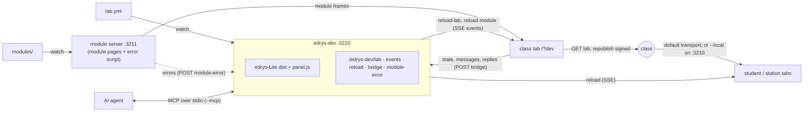

# edrys-dev

Build and try out an [edrys-Lite](https://github.com/edrys-labs/edrys-Lite) lab on your own computer before you share it with your students.

You write your lab in a file (`lab.yml`), `edrys-dev` opens it as a class in your browser, and every time you save the file the class updates in all open tabs. No account and no deploy needed while you work.

## Quick start

You need [Node.js](https://nodejs.org) 20 or newer.

1. Make a folder for your lab and create a file `lab.yml` in it:

   ```yaml
   name: My first lab
   meta:
     description: Trying out edrys-dev.
   modules:
     - url: https://edrys-labs.github.io/module-markdown-it/index.html
       config:
         content: |
           # Welcome

           Edit lab.yml, save it, and watch this text change.
       width: full
       height: tall
   ```

2. Start edrys-dev in that folder:

   ```bash
   npx @edryslabs/edrys-dev lab.yml --open
   ```

   Your browser opens the class. In the terminal you see two addresses:

   ```
   edrys-dev: /home/you/my-lab/lab.yml
     http://localhost:3210/?dev
   class open, share link:
     http://localhost:3210/?/classroom/…
   ```

3. Change something in `lab.yml` and save. The class updates on its own.

If you use edrys-dev often, install it once with `npm install -g @edryslabs/edrys-dev` and then start it with just `edrys-dev lab.yml --open`.

Stop it with `Ctrl+C`.

## Working on a lab

- **The `/?dev` tab is yours.** It is the teacher's view of the class. Keep it open: it is the tab that picks up your changes to `lab.yml`.
- **Try the lab as a student or station.** Open the share link in a *different* browser or a private window. In the same browser you would be the teacher again.
- **The file wins.** Anything you change in the class's Settings dialog is replaced the next time you save `lab.yml`. Make your changes in the file.
- **Restarting is safe.** The same `lab.yml` reopens the same class, so share links you opened before keep working.
- **Mistakes are reported.** If the class cannot take your lab (for example a YAML typo), the terminal prints `lab error: …`. Fix the file and save again.
- **Offline?** Start with `--local`. The class then connects through edrys-dev itself instead of the internet.

Which modules exist and how to configure them is described in the [edrys-Lite documentation](https://github.com/edrys-labs/edrys-Lite) and the [edrys skills](https://github.com/edrys-labs/skills).

### When the lab is done

Publish `lab.yml` the way you normally would, for example in a GitHub repository with a deploy link to https://edrys-labs.github.io. Nothing from edrys-dev ends up in the file.

## Writing your own modules

If you are also writing a module, put it into a `modules/` folder next to the lab, one subfolder per module:

```
my-lab/
├── lab.yml
└── modules/
    └── my-module/
        └── index.html
```

edrys-dev serves this folder on the next port (3211 by default). Use that address in `lab.yml`:

```yaml
modules:
  - url: http://localhost:3211/my-module/index.html
```

When you save a file in `modules/my-module/`, only that module reloads in the class. Errors from your module's page are collected so an AI agent can see them (see below).

These addresses only work on your computer. Publish the module (for example on GitHub Pages) and put its real address into `lab.yml` before you share the lab.

## With an AI agent

edrys-dev can work together with an AI coding agent such as Claude Code or GitHub Copilot. The agent edits `lab.yml` for you, sees whether the class accepts it, and can look into the class: rooms, users, modules and their messages.

### Setup

The quick way, for a new lab:

```bash
npx @edryslabs/edrys-dev init my-lab
```

This makes the folder `my-lab` with a starter `lab.yml`, the agent configuration for Claude Code (`.mcp.json`) and VS Code Copilot (`.vscode/mcp.json`), instructions for the agent (`AGENTS.md`, `CLAUDE.md`), Claude Code settings that let the agent use edrys-dev and edit `lab.yml` and `modules/` without asking each time (`.claude/settings.json`), and a `.gitignore`. In a folder that already has some of these files, it keeps them. If the edrys skills (step 2 below) are not installed yet, it offers to install them for you. Then open the folder in your agent and write "start".

By hand:

1. Create a file `.mcp.json` in your lab folder:

   ```json
   {
     "mcpServers": {
       "edrys": { "command": "npx", "args": ["-y", "@edryslabs/edrys-dev", "--mcp", "lab.yml"] }
     }
   }
   ```

   If you installed edrys-dev globally, `"command": "edrys-dev", "args": ["--mcp", "lab.yml"]` starts faster.

2. Install the edrys skills, so the agent knows how labs and modules are written:

   ```bash
   npx skills add edrys-labs/skills
   ```

3. Start your agent in the lab folder. **The agent starts edrys-dev itself**; don't start it by hand as well. If the folder has no `lab.yml` yet, edrys-dev creates a starter lab there. Ask the agent for the class address if your browser doesn't open it.

### Talking to the agent from the class

The class tab has a chat button (🤖, bottom right). What you write there goes straight to the agent. Only you see this chat; it is not the class chat. The agent can answer with text and also with buttons or checkboxes for you to pick from.

When the class cannot take your lab file, for example after a typing mistake, a red note in the chat says so in plain words, with edrys-Lite's message under "Details". It goes away once the file loads again.

Under your message you see "Waiting for the agent…" until the agent picks it up, then "Thinking…". If nothing happens for 30 seconds, the agent may not be listening. Your message is kept and answered once it is.

Some agents don't notice new messages on their own while they are idle. In that case start the `chat` prompt of the edrys server once (in VS Code Copilot: type `/edrys.chat`, or `/mcp.edrys.chat` in older versions), and the agent keeps waiting for your messages.

Chats are saved in `.edrys-dev/chats/` next to the lab, so a restarted agent can pick up where you left off. The menu at the top of the chat starts a new chat or reopens an old one. Add `.edrys-dev/` to your `.gitignore`.

For safety, the chat only accepts messages from the class page on your own computer. Other websites or people on your network cannot write to your agent, as long as you keep `--host` at its default.

### What the agent can do

| Tool | |
|---|---|
| `get_state` | the lab file, class address, share link, rooms, users and modules |
| `goto` | move your class tab to a room, or open a student or station tab |
| `chat`, `read_chat` | write to you in the class chat, read your messages |
| `read_messages` | messages between modules, and errors from your own modules |
| `read_module_state` | what the modules share in a room |
| `run_in_module` | run JavaScript inside one of your own modules, only when you ask for it |
| `wait_for_event` | wait for the next thing that happens in the class |

## Options

```
edrys-dev [lab.yml] [options]
```

| Option | Default | |
|---|---|---|
| `[lab.yml]`, `-i, --input <file>` | `./lab.yml` | the lab file, YAML or JSON |
| `-o, --open` | off | open the class in the browser |
| `-p, --port <port>` | `3210` | if it is taken, the next free port is used |
| `--local` | off | connect the class through edrys-dev instead of the internet; works offline |
| `-m, --modules <dir>` | `./modules`, if it exists | folder with your own modules |
| `--host <host>` | `127.0.0.1` | `0.0.0.0` lets others on your network open the class (and, with `--mcp`, write to your agent) |
| `--mcp` | off | for AI agents; set it in `.mcp.json`, see above |
| `-h, --help` | | show help |

## Troubleshooting

- **`no lab file at …`**: edrys-dev looks for `lab.yml` in the current folder. Start it in your lab folder or give the path: `edrys-dev path/to/lab.yml`.
- **The share link opens me as the teacher.** Open it in another browser or a private window.
- **My changes in Settings are gone.** They are replaced by `lab.yml` on every save. Put them into the file.
- **The class doesn't connect / no internet.** Try `--local`.
- **A different port than 3210.** Another program uses it; edrys-dev took the next free one. The terminal shows the address.
- **The agent doesn't answer in the chat.** Check that your agent is running in the lab folder with `.mcp.json`, and if it does not wake up on its own, start the `chat` prompt (see above).

## Development

To work on edrys-dev itself:

```bash
npm install
npm run build    # tsc → dist/
npm test         # builds, then runs test/*.test.js
```

How the parts talk to each other:



- `index.ts` reads the options and starts the server, and with `--mcp` the MCP server (`mcp.ts`).
- `server.ts` serves edrys-Lite, watches the lab (`watch.ts`) and talks to the class tab: events go out over SSE, the tab's reports come back over `POST /edrys-dev/bridge`.
- In the class tab, edrys-Lite's own `DevBridge` (`src/ts/DevBridge.ts` in edrys-Lite, active with `?dev`) loads and republishes the lab and reports the class. edrys-dev adds `views/panel.js` to the page: the agent chat (`chat.ts` on the server), and in student and station tabs the reload on module changes.
- `modules.ts` serves local modules on the next port and adds the error reporter to their pages.
- `sync.ts` is the Yjs sync for `--local`, on edrys-dev's own port.

edrys-Lite comes from npm as [`@edryslabs/edrys-lite`](https://www.npmjs.com/package/@edryslabs/edrys-lite), pinned to one version: its `dist/` is what edrys-dev serves. To try changes to edrys-Lite, build it (`npm run build` there) and link the checkout with `npm install ../edrys-Lite`; pin the published version again afterwards. The same goes for [`@edryslabs/websocket-server`](https://www.npmjs.com/package/@edryslabs/websocket-server), an optional dependency that only `--local` uses.

Issues and pull requests: https://github.com/edrys-labs/edrys-devserver

## License

[MIT](LICENSE). The MCP server and the agent chat follow [LiaScript DevServer](https://github.com/LiaScript/LiaScript-DevServer) (MIT).
